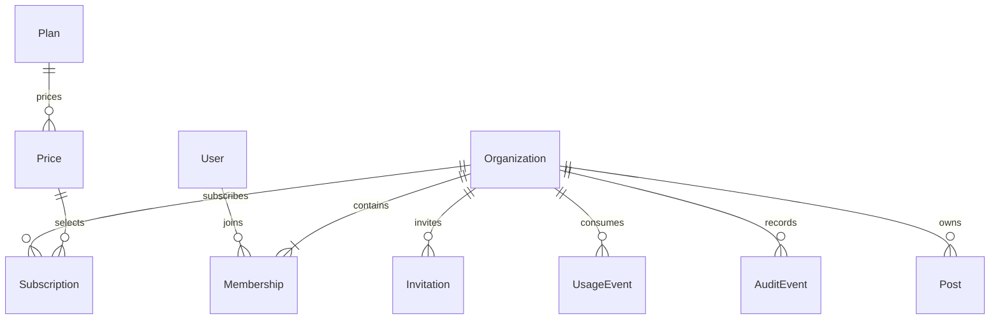

# 统一架构约定

状态：拟议架构，供后续模块实施时遵循；本文不新增应用行为。

## 核心模型与边界

- User 是全局登录身份，Organization 是租户、资源及计费边界；Membership 表示用户在特定组织的权限。
- Organization 必须至少保留一位 owner；Subscription 保留历史，但同一组织至多一个当前主订阅。
- AdminUser 是平台身份，不能与组织 owner 混用。运营跨租户访问必须显式授权并审计。
- 租户表统一包含 organization_id，创建时由服务端上下文赋值；严禁信任请求体中的租户归属。
- 新增 User/AdminUser 外键类型需匹配当前数据库 ID 类型；当前 schema 中这两张表为 integer，不能盲目按其他新表的 bigint 类型生成引用。

## 请求与授权链路

认证身份 → 根据路径解析组织 → 校验有效成员/服务身份 → 校验资源 Policy → 检查套餐权益及配额 → 执行业务 → 审计与事件。

- 组织列表只列当前身份可访问的组织；租户资源必须从已授权的组织 scope 查询。
- 查询、计数、搜索、导出、附件、缓存、后台任务均沿用同一边界。
- 无认证返回 401；已属于当前组织但无动作权限返回 403；不可见组织或资源返回 404。
- 失效成员立即失去访问权限，不将永久角色快照直接写进长期 JWT。

## Rails 代码落点

| 职责 | 拟议位置 | 约束 |
| --- | --- | --- |
| 数据模型与约束 | app/models、db/migrate | 模型校验之外增加数据库唯一索引、外键及非空约束 |
| API 编排 | app/controllers/api/v1 | 控制器只负责认证、参数、调用及响应 |
| 业务事务 | app/services/模块名 | 复杂状态流转统一服务，避免控制器和 Job 各自实现 |
| 权限 | app/policies | 拟新增；统一 action 和 scope，是否使用权限库在实施时决定 |
| 请求上下文 | app/models/current.rb | 拟新增；显式设置与清理，不能作为唯一安全边界 |
| 异步处理 | app/jobs | 复用 ActiveJob/GoodJob；携带租户、幂等标识并复核状态 |
| JSON 展示 | app/views/api/v1 | 延续 Jbuilder；不直接暴露完整模型字段 |
| 后台 | app/admin | 复用 ActiveAdmin 并补充平台角色权限 |
| 测试 | spec/models、spec/requests、spec/services、spec/jobs | 按新增行为补充，不只验证正常路径 |

以上新增目录仅为实现约定，本次不创建空业务代码或安装依赖。

## API 约定与兼容

- 现有 `/users/*` 认证入口保持兼容；新增租户接口以 `/api/v1/organizations/:organization_id` 为前缀。模块中的 `.../resource` 均指此前缀。
- 新接口拟采用 `{ data, meta }` 成功响应及 `{ errors: [{ code, message, field }], request_id }` 错误响应；现有接口并未全部采用，不应未经兼容评估统一替换。
- 创建返回 201；异步受理返回 202 并附查询地址；无内容删除返回 204。参数缺失为 400，校验失败为 422，状态冲突为 409，请求限流为 429。
- 现有验证错误状态与上述约定有差异；只对新接口使用新协议，存量调整需兼容测试，必要时新版本。
- 分页默认 20、上限 100（拟议值）；排序和筛选白名单，稳定排序补充 ID；大规模导出走任务。
- 时间使用带时区 ISO 8601；金额使用最小货币单位整数及币种。具体币种精度由支付渠道适配器处理。

## 事务、幂等与外部系统

- 数据库事务包住业务写入、审计和 outbox；外部网络请求不在长事务内执行。
- 拟新增 `OutboxEvent(event_id, organization_id, kind, payload, published_at)`；扫描器投递后标记，崩溃可能重复投递，消费方按 event_id 幂等处理。
- 重要创建/外部写入支持 Idempotency-Key。拟新增幂等记录以组织、调用身份、动作及 key 联合唯一，保存请求摘要、状态和结果；同 key 不同参数返回 409。
- 未完成幂等请求返回处理中或冲突，超时有恢复流程；完成后重放保存的结果。保留期限覆盖业务重试窗口，不能过早清理后重复扣款。
- Webhook 验签基于原始正文；仅在可靠接收事件后确认，事件去重后异步处理。验签失败拒绝，数据库不可用返回可重试错误。
- 外部副作用采用至少一次处理配合业务幂等；不能把 GoodJob 重试误认为天然只执行一次。

## 状态、删除与一致性

- 状态字段使用明确枚举和值，状态转换集中在服务中，并发转换加锁或使用乐观版本控制。
- 软删除仅表达业务状态，不能替代最终数据清理；删除关系、保留周期及恢复流程由 12 管理。
- 权限、成员数量、套餐权益变更需要同步失效缓存；计费用量以可靠账本为依据，不以展示统计作为收费依据。
- 服务端时间为准，组织时区影响展示；计费周期边界持久化，不根据浏览器时区推算。

## 迁移与上线

1. 添加兼容字段与索引；大表操作单独评估锁和执行时长。
2. 分批回填，核对数量、归属、重复值和孤儿记录。
3. 切换写入及查询，观察错误、延迟和任务积压。
4. 校验后增加约束，最后移除旧路径；为不可逆数据变更准备备份及补偿。
5. 功能开关仅控制业务开放，不能替代数据库迁移回退或支付补偿。

## 共用验收检查

- 正常、无认证、无权限、跨租户、无效输入和并发请求。
- 重复提交、重复 Job、回调乱序、外部超时和失败重试。
- 列表分页、搜索字段、N+1、敏感信息脱敏和可观测性。
- 存量兼容、迁移校验和恢复演练；实施时按实际变化选择测试范围。

## 实施前决策清单

| 决策 | 草案默认值 / 待确认内容 |
| --- | --- |
| 产品对象 | 多组织 SaaS，个人用户采用单成员组织 |
| 用户端 | 延续现有页面或 API 客户端，按实际产品决定 |
| 租户存储 | 共享库共享表，显式租户 scope |
| 固定角色 | owner / admin / member / viewer |
| 套餐及价格 | 待产品确定；无收费需求时使用静态免费权益 |
| 支付/邮件/存储渠道 | 实施时选择并核对官方接入文档 |
| 试用、宽限及保留周期 | 必须明确后配置，不在代码中散落硬编码 |
| 企业协议及法定要求 | 单独评估；本文不声明满足某项认证或法律要求 |
| 可用性与恢复目标 | 上线前确定 SLO、RPO、RTO 和负责人 |
